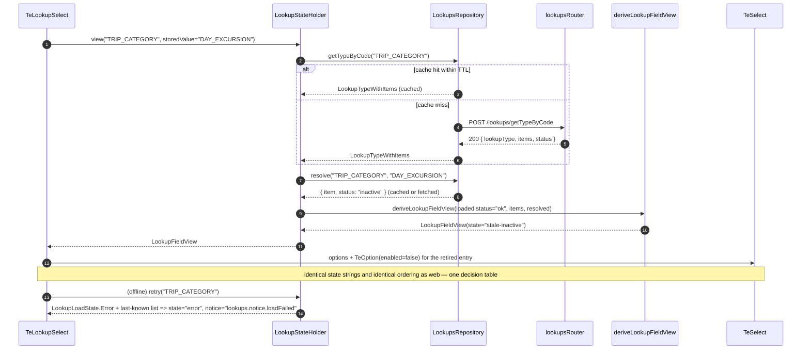

# System Design: Backend-Driven Lookup System

**Owner:** Gao (Architect) · **Status:** For implementation · **PRD:** `docs/lookups-prd.md` (P0 = LK-01…LK-24)
**Scope:** `packages/db`, `packages/api`, `packages/domain`, `packages/services/{trips,fleet}`, `packages/ui`, `apps/web`, `mobile/shared`, `scripts/`

---

## 1. Implementation approach

Five hard problems, and the decision for each.

| Problem                                                                                                                                                                                                              | Decision                                                                                                                                                                                                                                                          | Why                                                                                                                                                  |
| -------------------------------------------------------------------------------------------------------------------------------------------------------------------------------------------------------------------- | ----------------------------------------------------------------------------------------------------------------------------------------------------------------------------------------------------------------------------------------------------------------- | ---------------------------------------------------------------------------------------------------------------------------------------------------- |
| **Retirement vs. deletion.** Only `isDeleted` exists, so an option can only be retired by destroying history.                                                                                                        | Add `isActive boolean not null default true` to **both** tables, orthogonal to `isDeleted`. Read paths filter `isActive && !isDeleted`; `resolve` and `validate` look at all four combinations.                                                                   | LK-01. Two flags answer two questions: "may I offer this?" (active) and "did this ever exist?" (deleted). One flag cannot.                           |
| **Silent fallback hides drift.** `createLookupsRepository` serves `DEFAULT_LOOKUP_TYPES`/`DEFAULT_LOOKUPS` whenever a table is empty, fabricating ids from array indexes, so an unseeded deploy looks healthy.       | Delete the fallback from the read path. The catalog becomes a **seed source only**. Empty tables return a `not_seeded` status.                                                                                                                                    | LK-07. A broken deployment must fail loudly. `not_seeded` is a client-visible state (PRD §5 row a), not an exception.                                |
| **Client and server disagree on the token.** 134 sites ship inline arrays; forms submit `day_trip` while the seed holds `DAY_EXCURSION`; `APPLICATION_STATE.value` is `Submitted` while callers compare `submitted`. | **The select's `value` is `item.code`, never `item.value`.** `value` stays in the table (OQ-4) but is never rendered and never compared. Matching stored values to options is by `normalizeLookupCode`, so legacy lowercase/space-separated values still resolve. | LK-03/LK-04. `code` is already unique per type, immutable and what the seed is authored in. Switching to it removes the entire class of casing bugs. |
| **"Consistent on web and mobile" is a promise, not a mechanism.** Both platforms would otherwise re-derive the five PRD §5 cases in screen code.                                                                     | One **pure** function, `deriveLookupFieldView`, in `packages/domain`, mirrored 1:1 in Kotlin, driven by one shared JSON vector file. Both test suites read the same vectors.                                                                                      | LK-16/LK-17. A decision table implemented twice by hand diverges. Implemented once and mirrored against shared vectors, it cannot.                   |
| **Drift is caught in review, if at all.**                                                                                                                                                                            | `scripts/lookups.ts`, a guard in the `scripts/services.ts` shape (Bun, `#!/usr/bin/env bun`, exported registry const, `check` subcommand), plus a `lookups.config.json` allowlist that requires `reason` + `owner`.                                               | LK-14/LK-22. Same tool shape as the existing architecture check, so there is one way to write a repo guard.                                          |

**No new runtime dependency.** No AST parser, no new package. The guard is a scoped text scan (see §8); the pure logic is plain TypeScript with no imports.

**Layering constraint resolved.** Rule 1 of `.claude/rules/service-architecture.md` allows only a service's `repository` layer to import `@trips-app/db`, and `createLookupsRepository` is exported from `@trips-app/db`. Therefore a service's `services` layer cannot call it. The contract is:

1. **Each service's `repository`** exposes `findLookupStatus(typeCode: string, code: string): Promise<LookupStatus>` (`"active" | "inactive" | "deleted" | "unknown" | "unknown_type"`), implemented by delegating to `createLookupsRepository(db).resolve(...)`. Three lines, one shape, repeated verbatim per service.
2. **`@trips-app/domain`** owns the _policy_: `evaluateLookupAssignment({ nextCode, storedCode, status })` decides whether a write may proceed (LK-19's unchanged-value rule). Pure, no I/O.
3. **A service's `services` layer** calls its own repository, then the domain policy. No second `Context`, no new service package, no cross-service import.

`bun run services:check` enforces 1 and 3 unchanged.

**Architecture pattern.** Existing layered per-service architecture (routes → services → repository) plus a pure-domain core. The router stays a system router at `packages/api/src/routers/lookups.ts` with `publicProcedure` + `requireAdminSubRoles("super_admin","operations")`. No `packages/services/lookups` package is created.

---

## 2. File list

### `packages/domain` (pure, no I/O)

| File                                             | Change  | Purpose                                                                                                                                                                                                                          |
| ------------------------------------------------ | ------- | -------------------------------------------------------------------------------------------------------------------------------------------------------------------------------------------------------------------------------- |
| `src/types/index.ts`                             | modify  | `LookupTypeCode` union +36; `isActive` on `LookupItemDto`/`LookupTypeDto`; new `LookupTypeSummaryDto`, `LookupTypeReadStatus`, `LookupResolveStatus`, `LookupValidateReason`, `LookupStatus`; four new `SharedErrorCode` members |
| `src/lookups.ts`                                 | modify  | `LOOKUP_TYPE_CODES` +36; 36 `DEFAULT_LOOKUP_TYPES` entries; bilingual `DEFAULT_LOOKUPS` items for each; canonical `normalizeLookupCode`; `localizeLookupText` fallback-to-`code`; compile-time union↔array parity assertion      |
| `src/lookup-options.ts`                          | **new** | `deriveLookupFieldView` — the PRD §5 decision table, pure                                                                                                                                                                        |
| `src/lookup-validation.ts`                       | **new** | `evaluateLookupAssignment` — LK-19 write policy, pure                                                                                                                                                                            |
| `src/error-codes.ts`                             | modify  | 4 new codes + catalog entries (`LOOKUP_CODE_UNKNOWN`, `LOOKUP_CODE_INACTIVE`, `LOOKUP_CODE_DELETED`, `LOOKUP_NOT_SEEDED`)                                                                                                        |
| `src/index.ts`                                   | modify  | re-export the two new modules                                                                                                                                                                                                    |
| `src/lookup-options.test.ts`                     | **new** | table-driven test over the shared vectors                                                                                                                                                                                        |
| `src/lookup-validation.test.ts`                  | **new** | unchanged-value rule, all statuses                                                                                                                                                                                               |
| `test/fixtures/lookup-option-state.vectors.json` | **new** | **single source of truth** for PRD §5 rows a–e                                                                                                                                                                                   |

### `packages/db`

| File                                        | Change  | Purpose                                                                                                             |
| ------------------------------------------- | ------- | ------------------------------------------------------------------------------------------------------------------- |
| `src/schema/lookups.ts`                     | modify  | `isActive` on both tables; 2 new composite indexes                                                                  |
| `src/migrations/0001_lookups_is_active.sql` | **new** | hand-written, idempotent DDL (authoritative for non-`push` environments)                                            |
| `src/lookups.ts`                            | modify  | delete the static fallback; six-method repository API; deterministic ordering; `includeInactive`/`includeDeleted`   |
| `src/seed/lookups.ts`                       | modify  | seed `isActive: true`; return `expectedTypeCount`; `verifyLookupSeed`                                               |
| `src/seed/cli.ts`                           | modify  | run `verifyLookupSeed` after seeding, exit 1 on shortfall                                                           |
| `src/types/index.ts`                        | modify  | `LookupSeedSummary` gains `expectedTypeCount`; `LookupInsert`/`LookupTypeInsert` pick up `isActive` from the schema |

### `packages/api`

| File                          | Change  | Purpose                                                                                                   |
| ----------------------------- | ------- | --------------------------------------------------------------------------------------------------------- |
| `src/routers/lookups.ts`      | modify  | five read procedures with `status` discriminators; `resolve`; `validate`; `setItemActive`/`setTypeActive` |
| `src/routers/lookups.test.ts` | **new** | input-schema and status-mapping unit tests (no DB)                                                        |

### `packages/services`

| File                                   | Change  | Purpose                                                                        |
| -------------------------------------- | ------- | ------------------------------------------------------------------------------ |
| `trips/src/repository/index.ts`        | modify  | `findLookupStatus`                                                             |
| `trips/src/model/index.ts`             | modify  | drop `getStaticLookupByCode`; `isValidTripCategoryCode` → status-based         |
| `trips/src/services/index.ts`          | modify  | call repo + `evaluateLookupAssignment` on create/patch                         |
| `trips/test/lookup-validation.test.ts` | **new** | LK-19 cases                                                                    |
| `fleet/src/repository/index.ts`        | modify  | `findLookupStatus`                                                             |
| `fleet/src/model/index.ts`             | modify  | drop `VEHICLE_AMENITY_CODES` enum + `getStaticLookupByCode`                    |
| `fleet/src/services/index.ts`          | modify  | validate category and amenity codes against `VEHICLE_TYPE` / `VEHICLE_AMENITY` |
| `fleet/test/lookup-validation.test.ts` | **new** | amenity + category rejection, unchanged-value pass                             |

### `packages/ui`

| File                           | Change | Purpose                                                                                                             |
| ------------------------------ | ------ | ------------------------------------------------------------------------------------------------------------------- |
| `src/components/te-select.tsx` | modify | `TeSelectOption.disabled?`; `notice?`, `onRetry?` props. Still presentational, still no `@trips-app/api` dependency |

### `apps/web`

| File                                                                                                                    | Change      | Purpose                                                                                                                           |
| ----------------------------------------------------------------------------------------------------------------------- | ----------- | --------------------------------------------------------------------------------------------------------------------------------- |
| `src/utils/lookups.ts`                                                                                                  | **rewrite** | `useLookupField` / `useLookupOptions` / `useLookupResolve`; `toTeSelectOptions`; re-export normalisation from `@trips-app/domain` |
| `src/components/lookup-select.tsx`                                                                                      | **new**     | `LookupSelect` — hook + `TeSelect` + notice + retry                                                                               |
| `src/utils/lookups.test.ts`                                                                                             | **new**     | five states + fixture parity                                                                                                      |
| `src/screens/**` (~40 files)                                                                                            | modify      | replace inline option arrays with `LookupSelect`                                                                                  |
| `src/screens/organization/trips/trip-wizard-step-1-basics.tsx`                                                          | modify      | LK-21: default `DAY_EXCURSION`, drop `CULTURAL_HERITAGE`                                                                          |
| `src/screens/public/sign-up/{organization,platform-driver,photographer}-sign-up.tsx`, `src/screens/onboarding-state.ts` | modify      | LK-21: `COMMERCIAL_REGISTRATION`, `VEHICLE_INSURANCE`, `PORTFOLIO_SAMPLE`                                                         |

### `mobile/shared`

| File                                                        | Change              | Purpose                                                                                     |
| ----------------------------------------------------------- | ------------------- | ------------------------------------------------------------------------------------------- |
| `.../lookups/Lookups.kt`                                    | modify              | `isActive` + `status` on DTOs; `resolve`/`validate` calls; TTL cache; `LookupTypeCodes` +36 |
| `.../lookups/LookupFieldState.kt`                           | **new**             | Kotlin mirror of `deriveLookupFieldView`                                                    |
| `.../lookups/LookupStateHolder.kt`                          | **new**             | Compose state holder + `rememberLookupStateHolder()`                                        |
| `.../ui/components/TeSelect.kt`                             | modify              | `TeOption.enabled`, `notice`, `onRetry`                                                     |
| `.../ui/components/TeLookupSelect.kt`                       | **new**             | mobile `LookupSelect`                                                                       |
| `.../commonTest/.../lookups/LookupFieldStateTest.kt`        | **new**             | same vectors as TS                                                                          |
| `.../commonTest/.../lookups/LookupStateVectors.kt`          | **new (generated)** | vectors as a Kotlin `const val` + sha256                                                    |
| `.../commonTest/resources/lookup-option-state.vectors.json` | **new (generated)** | checked-in copy for review/diffing                                                          |

### root

| File                               | Change  | Purpose                                                                       |
| ---------------------------------- | ------- | ----------------------------------------------------------------------------- |
| `scripts/lookups.ts`               | **new** | drift guard + fixture generator                                               |
| `lookups.config.json`              | **new** | allowlist (presentational lists) + field registry                             |
| `package.json`                     | modify  | `lookups:check`, `lookups:fixtures`, `check` aggregate, `lint-staged`         |
| `apps/server/test/lookups.test.ts` | **new** | e2e: five procedures, 200-on-absent, resolve/validate, ordering, `not_seeded` |

---

## 3. Data model

### 3.1 Columns

```sql
ALTER TABLE lookup_types ADD COLUMN IF NOT EXISTS is_active boolean NOT NULL DEFAULT true;
ALTER TABLE lookups      ADD COLUMN IF NOT EXISTS is_active boolean NOT NULL DEFAULT true;
```

`value` stays. It is `NOT NULL` today, is what legacy rows were written with, and OQ-4 defers its removal. It is **never** rendered, compared, or sent as a select value.

### 3.2 Indexes (the read paths)

```sql
CREATE INDEX IF NOT EXISTS lookups_type_active_idx
  ON lookups (lookup_type_id, is_active, is_deleted, sort_by, code);
CREATE INDEX IF NOT EXISTS lookup_types_active_idx
  ON lookup_types (is_active, is_deleted, sort_by, code);
```

`lookups_type_active_idx` covers LK-02's `sortBy, code` ordering as an index-ordered scan for `getType` (the hottest read: one type, all active items). `lookup_types_active_idx` covers `listTypes`. `lookups_code_idx` (existing) covers `resolve` by code. The existing `lookups_type_idx` is superseded but **left in place** — dropping it is a separate cleanup with no P0 value.

### 3.3 Migration source of truth

`packages/db/src/migrations/` holds only `.gitkeep`; there is no journal. Running `db:generate` now would emit a **full-schema baseline** that conflicts with the `drizzle-kit push` workflow the team actually uses.

**Decision:** the **hand-written `0001_lookups_is_active.sql` is authoritative**, and `db:generate` is not used for this change. It is idempotent (`IF NOT EXISTS` throughout), so `db:push` and `psql -f` converge on the same state: dev uses `bun run db:push` from `src/schema/lookups.ts` (the SQL is a no-op there); staging and prod apply the SQL before the API rolls, and re-running is safe. Baselining the journal is a separate, non-blocking task (§14 item 2) that nothing here depends on.

---

## 4. Data structures and interfaces

### 4.1 Wire DTOs (`packages/domain/src/types/index.ts`)

Response keys are **kept**, not renamed. `lookupTypes` / `lookupType` already have four parsers (web helpers, two Kotlin data classes, the router). LK-09's acceptance criteria test _behaviour_ — a `status` discriminator, a flat list, `sortBy`/`code` order, HTTP 200 on absence — none of which depends on the key spelling. Renaming buys nothing and forces a four-client lockstep release. `status` and `items` are **additive**; `lookupType.items` stays for backward compatibility and is the same array instance as the top-level `items`.

```ts
export type LookupTypeReadStatus = "ok" | "type_not_found" | "not_seeded";
export type LookupResolveStatus =
  | "active"
  | "inactive"
  | "deleted"
  | "not_found"
  | "type_not_found";
export type LookupValidateReason = "ok" | "inactive" | "deleted" | "unknown_code" | "unknown_type";
export type LookupStatus = "active" | "inactive" | "deleted" | "unknown" | "unknown_type";

export interface LookupItemDto {
  id: number;
  uuid: string;
  code: string; // the public identifier; what entities store
  value: string; // legacy machine token; never rendered, never compared
  name: LookupLocalizedText; // both ar and en non-empty, enforced on write
  description: LookupLocalizedText | null;
  lookupTypeId: number;
  typeCode: string;
  parentId: number | null;
  parentCode: string | null; // flat, one level; no nested arrays
  sortBy: number;
  isPublic: boolean;
  isActive: boolean; // NEW
}

export interface LookupTypeDto {
  /* as today */ isActive: boolean;
}

export interface LookupTypeSummaryDto extends LookupTypeDto {
  itemCount: number; // active, non-deleted items only
}

// --- procedure responses ---
export interface ListTypesResponse {
  lookupTypes: LookupTypeSummaryDto[]; // ordered sortBy, code
  status: "ok" | "not_seeded";
}
export interface GetTypeByCodeResponse {
  lookupType: LookupTypeWithItemsDto | null;
  items: LookupItemDto[]; // === lookupType.items; flat, ordered
  status: LookupTypeReadStatus; // unknown code => 200 + "type_not_found"
}
export interface GetByTypeCodesResponse {
  lookupTypes: Record<string, LookupTypeWithItemsDto>; // missing codes absent, no throw
  list: LookupTypeWithItemsDto[];
  statuses: Record<string, LookupTypeReadStatus>;
  status: "ok" | "not_seeded";
}
export interface ResolveResponse {
  item: LookupItemDto | null;
  status: LookupResolveStatus;
}
export interface ValidateResponse {
  results: { code: string; valid: boolean; reason: LookupValidateReason }[];
}
```

### 4.2 The pure option-state function (`packages/domain/src/lookup-options.ts`)

Input is deliberately narrower than `LookupItemDto` so the Kotlin mirror is mechanical.

```ts
export interface LookupOptionItem {
  readonly code: string;
  readonly name: LookupLocalizedText;
  readonly description: LookupLocalizedText | null;
  readonly parentCode: string | null;
  readonly sortBy: number;
  readonly isActive: boolean;
}
export type LookupLoadState =
  | { readonly kind: "loading" }
  | { readonly kind: "error"; readonly message?: string }
  | {
      readonly kind: "loaded";
      readonly status: LookupTypeReadStatus;
      readonly items: readonly LookupOptionItem[]; // server order; never re-sorted
      readonly resolved: LookupResolution | null;
    }; // `resolve` result for storedValue

export interface LookupResolution {
  readonly status: LookupResolveStatus;
  readonly item: LookupOptionItem | null;
}

export type LookupFieldState =
  | "loading"
  | "ready"
  | "empty"
  | "stale-inactive"
  | "stale-unknown"
  | "error";

export type LookupNoticeKey =
  | "lookups.notice.typeUnavailable"
  | "lookups.notice.noOptions"
  | "lookups.notice.staleInactive"
  | "lookups.notice.staleUnknown"
  | "lookups.notice.loadFailed";

export interface LookupOptionView {
  readonly value: string; // === item.code
  readonly label: string; // localized, or the fallback entry
  readonly disabled: boolean;
  readonly reason: "inactive" | "deleted" | "unknown" | null;
}
export interface LookupFieldInput {
  readonly typeCode: string;
  readonly storedValue: string | null; // the value already on the entity; never rewritten
  readonly locale: SupportedLocale;
  readonly loadState: LookupLoadState;
  readonly required: boolean;
  readonly cachedLabel: string | null; // last-known-good label, for the error state
}

export interface LookupFieldView {
  readonly state: LookupFieldState;
  readonly options: readonly LookupOptionView[];
  readonly selectedValue: string | null; // exactly the stored string, or null
  readonly selectedLabel: string | null;
  readonly disabled: boolean; // the whole control
  readonly canSave: boolean;
  readonly canReselect: boolean;
  readonly notice: LookupNoticeKey | null;
  readonly retryable: boolean;
}

export function deriveLookupFieldView(input: LookupFieldInput): LookupFieldView;
```

**Derivation, in order (implement exactly this):**

| #   | Condition                                                            | `state`          | `options`                                                | `disabled` | `canSave`   | `canReselect` | `notice`          | `retryable` |
| --- | -------------------------------------------------------------------- | ---------------- | -------------------------------------------------------- | ---------- | ----------- | ------------- | ----------------- | ----------- |
| a1  | `loading`, no stored                                                 | `loading`        | `[]`                                                     | true       | `!required` | false         | —                 | false       |
| a2  | `loading`, stored                                                    | `loading`        | `[staleEntry(cachedLabel ?? stored, "unknown")]`         | true       | true        | false         | —                 | false       |
| b1  | `error`, no stored                                                   | `error`          | `[]`                                                     | true       | `!required` | false         | `loadFailed`      | **true**    |
| b2  | `error`, stored                                                      | `error`          | `[staleEntry(cachedLabel ?? stored, "unknown")]`         | true       | true        | false         | `loadFailed`      | **true**    |
| c1  | loaded, `status !== "ok"` (incl. unknown status), no stored          | `empty`          | `[]`                                                     | true       | `!required` | false         | `typeUnavailable` | false       |
| c2  | loaded, `status !== "ok"`, stored                                    | `stale-unknown`  | `[staleEntry(stored, "unknown")]`                        | true       | true        | false         | `typeUnavailable` | false       |
| d1  | loaded, `ok`, 0 items, no stored                                     | `empty`          | `[]`                                                     | true       | `!required` | false         | `noOptions`       | false       |
| d2  | loaded, `ok`, 0 items, stored                                        | `stale-unknown`  | `[staleEntry(stored, "unknown")]`                        | true       | true        | false         | `noOptions`       | false       |
| e1  | loaded, `ok`, items, no stored                                       | `ready`          | active options                                           | false      | `!required` | **true**      | —                 | false       |
| e2  | loaded, `ok`, items, stored **found** (normalised)                   | `ready`          | active options                                           | false      | true        | **true**      | —                 | false       |
| f1  | loaded, `ok`, stored **not** found, `resolved.status === "inactive"` | `stale-inactive` | active options + `staleEntry(resolvedLabel, "inactive")` | false      | true        | false         | `staleInactive`   | false       |
| f2  | … `"deleted"`                                                        | `stale-inactive` | active options + `staleEntry(resolvedLabel, "deleted")`  | false      | true        | false         | `staleInactive`   | false       |
| f3  | … `"not_found"` / `"type_not_found"` / `resolved === null`           | `stale-unknown`  | active options + `staleEntry(stored, "unknown")`         | false      | true        | false         | `staleUnknown`    | false       |

Invariants enforced by the function, not by callers:

- **`selectedValue` is always the raw stored string.** The function never rewrites, re-maps or clears it. (PRD §5, column 3: "Stored value preserved? Yes" in all five rows.)
- **`canSave = !required || storedValue !== null`.** One formula for every row: an untouched stored value is always allowed through (LK-19), and a required field with nothing stored blocks save.
- **`options` order is the input order.** No sorting. The server sorts by `sortBy, code` (LK-02) and the client renders as received.
- **`disabled` is the whole control; `option.disabled` is one entry.** In rows f1–f3 the control stays enabled so the user can pick a _different_ value; only the retired entry is unselectable. (PRD §5 c/d: "Re-selecting is impossible… it can only be cleared".)
- **`notice` is an i18n key, never prose.** Both platforms localize it from `@trips-app/i18n` / their own string table. Rows a1/d1 vs c1/c2 are distinguished by `notice`, since both render the `empty`/`stale-*` visual.
- **An unknown `status` string is not success.** `status !== "ok"` folds unknown values into rows c1/c2 (LK-13).
- **Matching is by `normalizeLookupCode`.** `day_excursion` matches `DAY_EXCURSION`; `day_trip` does **not** and surfaces as `stale-unknown`. That is the intended LK-21 behaviour: drift becomes visible instead of being silently remapped.

### 4.3 Kotlin mirror (`LookupFieldState.kt`)

Structurally identical; the function name, parameter names and state strings are the same so a diff between the two files is readable.

```kotlin
@Serializable
data class LookupOptionItem(
    @SerialName("code") val code: String,
    @SerialName("name") val name: LookupLocalizedText,
    @SerialName("description") val description: LookupLocalizedText? = null,
    @SerialName("parentCode") val parentCode: String? = null,
    @SerialName("sortBy") val sortBy: Int = 0,
    @SerialName("isActive") val isActive: Boolean = true,
)

sealed interface LookupLoadState {
    data object Loading : LookupLoadState
    data class Error(val message: String? = null) : LookupLoadState
    data class Loaded(
        val status: String,                       // "ok" | "type_not_found" | "not_seeded"
        val items: List<LookupOptionItem>,
        val resolved: LookupResolution? = null,
    ) : LookupLoadState
}

data class LookupResolution(val status: String, val item: LookupOptionItem? = null)

enum class LookupFieldState { Loading, Ready, Empty, StaleInactive, StaleUnknown, Error }

data class LookupOptionView(
    val value: String,
    val label: String,
    val disabled: Boolean = false,
    val reason: String? = null,                   // "inactive" | "deleted" | "unknown"
)

data class LookupFieldInput(
    val typeCode: String,
    val storedValue: String? = null,
    val locale: String = "ar",
    val loadState: LookupLoadState,
    val required: Boolean = false,
    val cachedLabel: String? = null,
)

data class LookupFieldView(
    val state: LookupFieldState,
    val options: List<LookupOptionView>,
    val selectedValue: String? = null,
    val selectedLabel: String? = null,
    val disabled: Boolean = false,
    val canSave: Boolean = true,
    val canReselect: Boolean = false,
    val notice: String? = null,                   // i18n key
    val retryable: Boolean = false,
)

fun deriveLookupFieldView(input: LookupFieldInput): LookupFieldView
```

### 4.4 Shared fixture mechanism

`packages/domain/test/fixtures/lookup-option-state.vectors.json` is the only hand-edited vector file. Shape:

```json
{
  "version": 1,
  "vectors": [
    {
      "id": "c-inactive-with-stored-value",
      "prdRow": "c",
      "input": {
        "typeCode": "TRIP_CATEGORY",
        "storedValue": "DAY_EXCURSION",
        "locale": "en",
        "required": true,
        "cachedLabel": null,
        "loadState": {
          "kind": "loaded",
          "status": "ok",
          "items": [
            {
              "code": "MULTI_DAY_TOUR",
              "name": { "en": "Multi-Day", "ar": "متعدد" },
              "sortBy": 2,
              "isActive": true
            }
          ],
          "resolved": {
            "status": "inactive",
            "item": {
              "code": "DAY_EXCURSION",
              "name": { "en": "Day Excursion", "ar": "رحلة يوم" },
              "sortBy": 1,
              "isActive": false
            }
          }
        }
      },
      "expected": {
        "state": "stale-inactive",
        "selectedValue": "DAY_EXCURSION",
        "selectedLabel": "Day Excursion (no longer available)",
        "disabled": false,
        "canSave": true,
        "canReselect": false,
        "notice": "lookups.notice.staleInactive",
        "retryable": false,
        "options": [
          { "value": "MULTI_DAY_TOUR", "label": "Multi-Day", "disabled": false, "reason": null },
          {
            "value": "DAY_EXCURSION",
            "label": "Day Excursion (no longer available)",
            "disabled": true,
            "reason": "inactive"
          }
        ]
      }
    }
  ]
}
```

**How Kotlin reads it.** The KMP build has no npm access and `commonTest` resources are not readable uniformly across the Android host, JS, Wasm and iOS-simulator targets without four `expect`/`actual` implementations. So the JSON is **not** loaded at test time. Instead `bun scripts/lookups.ts fixtures` reads the one JSON and writes two generated files:

1. `mobile/shared/src/commonTest/resources/lookup-option-state.vectors.json` — a byte-identical copy, so a reviewer can diff it in the repo.
2. `mobile/shared/src/commonTest/kotlin/com/tripsenjoy/lookups/LookupStateVectors.kt` — `const val VECTORS_JSON = """…"""` plus `const val VECTORS_SHA256 = "…"`.

`LookupFieldStateTest.kt` decodes `VECTORS_JSON` with `kotlinx.serialization` (already a `:shared` dependency) and asserts every `expected` field. `bun run lookups:check` re-runs the generator in `--check` mode and fails on any byte difference, so editing the TS fixture without regenerating breaks the build. Adding a vector requires one edit and one command.

---

## 5. Class diagram

```mermaid
classDiagram
  class LookupLocalizedText { +string ar; +string en }
  class LookupTypeDto { +string code; +LookupLocalizedText name; +string parentCode; +number sortBy; +boolean isActive }
  class LookupTypeSummaryDto { +number itemCount }
  class LookupTypeWithItemsDto { +LookupItemDto[] items }
  class LookupItemDto { +number id; +string code; +string value; +LookupLocalizedText name; +string parentCode; +number sortBy; +boolean isActive }
  class ResolveResponse { +LookupItemDto item; +LookupResolveStatus status }
  class ValidateResponse { +ValidateResult[] results }
  class LookupOptionItem { +string code; +LookupLocalizedText name; +string parentCode; +number sortBy; +boolean isActive }
  class LookupResolution { +LookupResolveStatus status; +LookupOptionItem item }
  class LookupLoadState { <<union>> loading / error / loaded }
  class LookupFieldInput { +string typeCode; +string storedValue; +string locale; +boolean required; +string cachedLabel }
  class LookupOptionView { +string value; +string label; +boolean disabled; +string reason }
  class LookupFieldView { +LookupFieldState state; +string selectedValue; +boolean disabled; +boolean canSave; +boolean canReselect; +string notice }
  class LookupsRepository { +listTypes(); +getTypeByCode(); +getByTypeCodes(); +resolve(); +validate() }
  class useLookupField { +LookupFieldView view; +retry() }
  class LookupStateHolder { +view(); +load(); +retry() }

  LookupTypeDto <|-- LookupTypeSummaryDto
  LookupTypeDto <|-- LookupTypeWithItemsDto
  LookupTypeWithItemsDto "1" o-- "*" LookupItemDto
  LookupItemDto --> LookupLocalizedText
  LookupTypeDto --> LookupLocalizedText
  ResolveResponse --> LookupItemDto
  ValidateResponse --> LookupItemDto
  LookupFieldInput --> LookupLoadState
  LookupFieldInput --> LookupResolution
  LookupLoadState --> LookupOptionItem
  LookupResolution --> LookupOptionItem
  LookupFieldView "1" o-- "*" LookupOptionView
  LookupFieldInput ..> LookupFieldView : deriveLookupFieldView()
  LookupsRepository ..> LookupTypeWithItemsDto : produces
  LookupsRepository ..> ResolveResponse : produces
  useLookupField ..> LookupFieldView : derives
  LookupStateHolder --> LookupsRepository
  LookupStateHolder ..> LookupFieldView : derives
```



---

## 6. Call flow (both flows hit the `resolve` path for a stale value)

**Web: a field whose stored value has been retired.**

```mermaid
sequenceDiagram
  autonumber
  participant S as LookupSelect
  participant H as useLookupField
  participant Q as TanStack Query
  participant API as lookupsRouter
  participant R as LookupsRepository
  participant D as deriveLookupFieldView
  participant T as TeSelect

  S->>H: render(typeCode, value="DAY_EXCURSION", required)
  H->>Q: getTypeByCode({ code: "TRIP_CATEGORY" })
  Q->>API: POST /lookups/getTypeByCode
  API->>R: getType(typeCode)
  R-->>API: { type, items(active only), status: "ok" }
  API-->>Q: 200 { lookupType, items, status }
  Q-->>H: items (DAY_EXCURSION absent)
  Note over H: stored code not in the active list
  H->>Q: resolve({ typeCode, code: "DAY_EXCURSION" })
  Q->>API: POST /lookups/resolve
  API->>R: resolve(typeCode, code)
  R-->>API: { item, status: "inactive" }
  API-->>Q: 200 { item, status: "inactive" }
  Q-->>H: resolved
  H->>D: deriveLookupFieldView({ items, storedValue, resolved, required })
  D-->>H: state="stale-inactive", options=[...active, disabled entry], canSave=true, canReselect=false
  H-->>S: LookupFieldView
  S->>T: options + selectedValue + notice="lookups.notice.staleInactive"
  T-->>S: <option disabled>DAY_EXCURSION — "Day Excursion (no longer available)"
  Note over S,T: the user may pick another value, never re-pick the retired one; an untouched field still saves
```

**Mobile: the same field, served from cache, then offline.**



---

## 7. Consumption contracts

### 7.1 Web (`apps/web/src/utils/lookups.ts`)

```ts
export interface UseLookupFieldOptions {
  typeCode: LookupTypeCode | string;
  value: string | null;
  locale?: SupportedLocale; // default: the active app locale
  required?: boolean;
  parentCode?: string;
}

export interface UseLookupFieldResult extends LookupFieldView {
  typeCode: string;
  isLoading: boolean;
  error: Error | null;
  retry: () => void; // refetch options + resolve
}

export function useLookupField(options: UseLookupFieldOptions): UseLookupFieldResult;

/** Multi-field forms: one request for N types (LK-10). */
export function useLookupOptions(typeCodes: readonly (LookupTypeCode | string)[]): {
  views: Record<string, LookupFieldView>; // per typeCode, storedValue = null
  isLoading: boolean;
  error: Error | null;
  retry: () => void;
};

/** Adapter for the presentational component; the only place that builds an array. */
export function toTeSelectOptions(view: LookupFieldView): TeSelectOption[];
```

The local `normalizeLookupCode` and `localizeLookupText` copies are **deleted** and re-exported from `@trips-app/domain`. They currently disagree with the domain (`[^A-Z0-9]+` vs `[\s-]+`) and with Kotlin; one rule, one file.

**`LookupSelect` lives in `apps/web/src/components/lookup-select.tsx`, not `packages/ui`.** Verified: `packages/ui/package.json` depends on `@trips-app/i18n` and React only — not on `@trips-app/api` or `@trips-app/domain`. `@trips-app/api` does not import `@trips-app/ui`, so adding the dependency would _not_ create a cycle, but it would make a presentational package depend on the transport layer and pull all 26 service packages into every `packages/ui` consumer. `packages/ui` therefore gains only `TeSelectOption.disabled` and `notice`/`onRetry` props — presentation, no data.

### 7.2 Mobile

`LookupStateHolder` is a plain class in `commonMain` (not an Android `ViewModel`, which would need a platform dependency). `view()` derives synchronously from cache and triggers a load; screens call `rememberLookupStateHolder()`, which reuses the existing `rememberApiClient()` and caches per composition — no new dependency, no change to the `:shared` → app-module rule (`ARCHITECTURE.md` §7.3), no `ApiClient` plumbing through every screen. The cache lives in `LookupsRepository` (per-`typeCode`, `cachedAt` + TTL, `forceRefresh` on retry), so the holder is cheap to recreate.

```kotlin
class LookupStateHolder(private val repository: LookupsRepository) {
    fun view(typeCode: String, storedValue: String?, locale: String = "ar", required: Boolean = false): LookupFieldView
    fun load(typeCodes: List<String>)      // one batch request for a multi-field form
    fun retry(typeCode: String)
}
@Composable fun rememberLookupStateHolder(): LookupStateHolder =
    rememberApiClient().let { api -> remember(api) { LookupStateHolder(LookupsRepository(api)) } }
```

---

## 8. Drift guard `scripts/lookups.ts`

Shape follows `scripts/services.ts`: `#!/usr/bin/env bun`, an exported registry const, a `main()` with subcommands, exit codes **0** = clean, **1** = violations, **2** = usage error.

```
bun scripts/lookups.ts check [--report] [--changed <file...>]
bun scripts/lookups.ts fixtures [--check]
```

`--report` prints violations and exits 0 (rollout mode, §10). `--changed` scopes rule (a)/(b) to the given files for lint-staged.

### 8.1 Rules

| Rule                                 | ID                                     | Detection                                                                                                                                                                                                                                                                                                                                                                                                                                                                                                                             | Scope                                                                      |
| ------------------------------------ | -------------------------------------- | ------------------------------------------------------------------------------------------------------------------------------------------------------------------------------------------------------------------------------------------------------------------------------------------------------------------------------------------------------------------------------------------------------------------------------------------------------------------------------------------------------------------------------------- | -------------------------------------------------------------------------- |
| (a) inline option array              | `lookup-domain-array`                  | An array literal (TS) or `listOf(...)` group (Kotlin) containing **≥2 object literals that each have both a `value`/`value =` key and a `label`/`label =` key**, or ≥2 `TeOption(` calls. Extract the `value` string literals. If that set (normalised) is a subset of one registered type's seeded code set → **violation**, and allowlisting it is itself an error (`allowlisted-domain-array`). If it matches no registered type → it is a presentational list and **must** have an allowlist entry (`unregistered-option-array`). | `apps/web/src/**`, `mobile/shared/src/commonMain/**`, `packages/ui/src/**` |
| (b) unregistered type code           | `unregistered-type-code`               | Any string literal passed as the first argument to `useLookupField(`, `useLookupOptions(`, `useLookupResolve(`, `getTypeByCode({ code:`, `getByTypeCodes({ codes:`, `getItemsByTypeCode(`, or assigned to a `LookupTypeCodes.*` use, that is not in `LOOKUP_TYPE_CODES`.                                                                                                                                                                                                                                                              | same                                                                       |
| (c) table read outside `packages/db` | `db-read-outside-repository`           | An import of `@trips-app/db` / `@trips-app/db/schema`, or a SQL string containing `lookup_types` or `\blookups\b`.                                                                                                                                                                                                                                                                                                                                                                                                                    | everything except `packages/db/**` and `packages/services/*/repository/**` |
| (d) registry field not wired         | `field-not-wired`                      | For each `fields[]` entry in `lookups.config.json`, the listed file must import the shared contract (`@/utils/lookups` on web, `com.tripsenjoy.lookups` on mobile) and must not define a local `*_OPTIONS` array.                                                                                                                                                                                                                                                                                                                     | `fields[].files`                                                           |
| (e) type-code parity (LK-22)         | `type-code-parity`                     | `LOOKUP_TYPE_CODES` (TS) ≡ `DEFAULT_LOOKUP_TYPES[].code` ≡ Kotlin `LookupTypeCodes` const values ≡ `DEFAULT_LOOKUPS[].typeCode` coverage. Symmetric difference must be empty.                                                                                                                                                                                                                                                                                                                                                         | the three registries                                                       |
| (f) fixture parity                   | `fixture-drift`                        | `fixtures --check` regenerates both mobile artefacts in memory and diffs them.                                                                                                                                                                                                                                                                                                                                                                                                                                                        | generated files                                                            |
| (g) seed completeness                | `seed-incomplete`                      | Every type has ≥1 `DEFAULT_LOOKUPS` item; every item has non-empty `name.ar` **and** `name.en` and an integer `sortBy`. Also the LK-07 CI assertion: seeded type count ≥ `LOOKUP_TYPE_CODES.length`.                                                                                                                                                                                                                                                                                                                                  | `packages/domain/src/lookups.ts`                                           |
| (h) allowlist hygiene                | `allowlist-invalid`, `allowlist-stale` | Every entry needs non-empty `reason` (≥20 chars) and `owner`, and its `file` must still exist and still match its recorded `fingerprint`.                                                                                                                                                                                                                                                                                                                                                                                             | `lookups.config.json`                                                      |

**How a domain array is told from a presentational one.** The discriminator is the _value set_, not the file or the variable name. Chart ranges (`1M`,`3M`,`6M`,`1Y`), page sizes (`10`,`25`,`50`), sort orders (`newest`,`price_asc`), tab sets (`overview`,`billing`) and density toggles (`comfortable`,`compact`) match no registered type's seeded code set, so they are classified presentational and require an allowlist entry with a written reason — which is exactly the "required registration for new arrays" the PRD asks for. A real domain array such as `[{value:"organization"},{value:"driver"},{value:"photographer"}]` matches `APPLICATION_TYPE` exactly and is reported as a violation that **cannot** be allowlisted. No parser dependency: the scan is limited to `value`+`label` object shapes and `TeOption(` calls, so unrelated object literals are never touched.

### 8.2 `lookups.config.json`

```json
{
  "$schema": "./scripts/lookups.schema.json",
  "allowlist": [
    {
      "file": "apps/web/src/screens/admin/finance/revenue-dashboard.tsx",
      "fingerprint": "1M|3M|6M|1Y",
      "reason": "Chart time-range control; UI configuration, not domain state (PRD §7.1).",
      "owner": "web-admin"
    }
  ],
  "fields": [
    {
      "id": "trip-wizard.category",
      "typeCode": "TRIP_CATEGORY",
      "files": ["apps/web/src/screens/organization/trips/trip-wizard-step-1-basics.tsx"]
    }
  ]
}
```

### 8.3 Wiring

```jsonc
"lookups:check":    "bun scripts/lookups.ts check",
"lookups:fixtures": "bun scripts/lookups.ts fixtures",
"check":            "oxlint && oxfmt --write && bun run services:check && bun run lookups:check",
"lint-staged": {
  "apps/web/src/**/*.{ts,tsx}":       ["bun scripts/lookups.ts check --changed"],
  "mobile/shared/src/**/*.kt":        ["bun scripts/lookups.ts check --changed"],
  "*.{js,jsx,mjs,cjs,ts,tsx,mts,cts}": ["oxlint"],
  "*": ["oxfmt --write"]
}
```

Note: the current `check` aggregate does not run `services:check`. Adding both is part of T7.

---

## 9. Task list

Ordered by dependency. **Phase 0** data layer · **Phase 1** API · **Phase 2** catalog, pure logic, guard · **Phase 3** web + services · **Phase 4** mobile.

| ID      | Task                                                           | Files touched                                                                                                                                                                                                                  | Deps       | Done criterion                                                                                                                                                                                                                                       | ∥                                                                   |
| ------- | -------------------------------------------------------------- | ------------------------------------------------------------------------------------------------------------------------------------------------------------------------------------------------------------------------------ | ---------- | ---------------------------------------------------------------------------------------------------------------------------------------------------------------------------------------------------------------------------------------------------- | ------------------------------------------------------------------- |
| **T1**  | Schema, migration, seed flags                                  | `db/src/schema/lookups.ts`, `db/src/migrations/0001_lookups_is_active.sql`, `db/src/seed/lookups.ts`, `db/src/seed/cli.ts`, `db/src/types/index.ts`                                                                            | —          | `db:push` on an empty DB yields both `is_active` columns and 2 indexes; applying the SQL twice does not error; seed writes `isActive: true` and returns `expectedTypeCount`                                                                          | ∥ T5                                                                |
| **T2**  | Repository rewrite, static fallback removed                    | `db/src/lookups.ts`                                                                                                                                                                                                            | T1         | No `DEFAULT_LOOKUP*`/`getStatic*` import remains in the file; six-method API in place; every query orders by `sortBy, code`; `check-types` clean                                                                                                     |                                                                     |
| **T3**  | Five read procedures + statuses + error codes                  | `api/src/routers/lookups.ts`, `api/src/routers/lookups.test.ts`, `domain/src/error-codes.ts`, `domain/src/types/index.ts`                                                                                                      | T2         | All five return HTTP 200 for every absent/empty/inactive permutation; `status` present on all five; `lookupTypes`/`lookupType` keys unchanged; 4 new error codes in the catalog                                                                      |                                                                     |
| **T4**  | Admin activate/deactivate + e2e contract suite                 | `api/src/routers/lookups.ts`, `apps/server/test/lookups.test.ts`                                                                                                                                                               | T3         | `setItemActive`/`setTypeActive` reject non-admins with `ADMIN_SUBROLE_FORBIDDEN`; deactivating removes the item from `getTypeByCode` and still resolves it as `inactive`; e2e green against Postgres                                                 |                                                                     |
| **T5**  | Catalog expansion + canonical normalisation + parity assertion | `domain/src/types/index.ts`, `domain/src/lookups.ts`, `mobile/shared/.../lookups/Lookups.kt` (`LookupTypeCodes` only)                                                                                                          | —          | 36 new type codes present in all three registries; each has ≥1 bilingual seed item with an integer `sortBy`; a missing array entry fails `check-types` via the compile-time assertion                                                                | ∥ T1                                                                |
| **T6**  | Pure option-state + validation logic + shared vectors          | `domain/src/lookup-options.ts`, `domain/src/lookup-validation.ts`, `domain/src/index.ts`, `domain/test/fixtures/lookup-option-state.vectors.json`, `domain/src/lookup-options.test.ts`, `domain/src/lookup-validation.test.ts` | T5         | One vector per PRD §5 row a–e, each asserting all four columns; `bun test packages/domain` green; the module imports nothing (no db, no api, no fs)                                                                                                  | ∥ T2–T4                                                             |
| **T7**  | Guard script, config, wiring                                   | `scripts/lookups.ts`, `scripts/lookups.schema.json`, `lookups.config.json`, `package.json`                                                                                                                                     | T5, T6     | `lookups:check` exits 1 naming file+line on a deliberately reintroduced inline array, and 0 on the post-T1 tree; an allowlist entry without `reason` fails; `fixtures --check` fails on a hand-edited generated file. Wired as `--report` in `check` |                                                                     |
| **T8**  | Web contract: hook, `LookupSelect`, `TeSelect` states          | `apps/web/src/utils/lookups.ts`, `apps/web/src/components/lookup-select.tsx`, `apps/web/src/utils/lookups.test.ts`, `packages/ui/src/components/te-select.tsx`                                                                 | T3, T6     | Tests cover loading/ready/empty/stale-inactive/stale-unknown/error; `normalizeLookupCode` re-exported from domain (no local copy); `TeSelectOption.disabled` renders `<option disabled>` and keeps `aria-describedby`                                | ∥ T10                                                               |
| **T9**  | Web call-site migration + LK-21 drift fixes                    | ~40 files under `apps/web/src/screens/**`, `apps/web/src/screens/onboarding-state.ts`                                                                                                                                          | T8         | `lookups:check` reports zero `lookup-domain-array` for `apps/web`; trip wizard stores `DAY_EXCURSION`; sign-up stores `COMMERCIAL_REGISTRATION` / `VEHICLE_INSURANCE` / `PORTFOLIO_SAMPLE`; no screen defines an options array for a registered type | ∥ T10, T11 (split by surface: traveler / business / admin / public) |
| **T10** | Service write validation (LK-19)                               | `services/trips/src/{repository,model,services}/index.ts`, `services/trips/test/lookup-validation.test.ts`, `services/fleet/src/{repository,model,services}/index.ts`, `services/fleet/test/lookup-validation.test.ts`         | T2, T6     | Create with `day_trip` fails with `LOOKUP_CODE_UNKNOWN` + field path; a PATCH re-sending the same retired value succeeds; `VEHICLE_AMENITY_CODES` is gone; `services:check` clean                                                                    | ∥ T8, T9                                                            |
| **T11** | Kotlin mirror, state holder, `TeSelect` states                 | `Lookups.kt`, `LookupFieldState.kt`, `LookupStateHolder.kt`, `TeSelect.kt`, `TeLookupSelect.kt`, `LookupFieldStateTest.kt`, `LookupStateVectors.kt` (gen), `commonTest/resources/…json` (gen)                                  | T3, T5, T6 | `./gradlew :shared:allTests` green on Android host, JS, Wasm, iOS simulator; the same five vectors pass; generated files byte-match the TS fixture                                                                                                   |                                                                     |
| **T12** | Mobile call-site migration + LK-21 + guard goes blocking       | `screens/public/signup/{PlatformDriverSignUp,PhotographerSignUp}.kt`, `auth/screens/PendingApprovalScreen.kt`, role screens, `package.json`                                                                                    | T11, T9    | `lookups:check` reports zero violations repo-wide for Kotlin; document codes match the seed; `check` flips from `--report` to blocking and lint-staged is active                                                                                     |                                                                     |

**Sizing:** 12 tasks across 5 phases, 3–8 files each — roughly 4–5 engineer turns. Tasks marked ∥ can run concurrently; the only serial spine is T1 → T2 → T3 → T4 and T5 → T6 → T8 → T9.

---

## 10. Rollout order, and what may temporarily fail

```
T1 schema+seed ─▶ T2 repo ─▶ T3 API ─▶ T4 admin+e2e ──▶ T8 web contract ─▶ T9 web sites ─┐
T5 catalog ─▶ T6 pure logic ─┬▶ T7 guard (--report) ─▶ T10 services ───────────────────────┼─▶ T12 blocking
                             └▶ T11 mobile ──────────────────────────▶ T12 mobile sites ────┘
```

- **Green at every step.** T1–T6 are additive and leave the tree type-clean. T3 keeps the existing response keys, so nothing breaks when it lands. T7 enters the `check` aggregate in `--report` mode (prints, exits 0), so the guard can be tuned against the real tree without blocking the web/mobile migration.
- **Temporarily allowed to fail:** `bun run lookups:check` in _blocking_ mode is expected to fail from T7 until T12 completes — that is why T7 wires `--report`. Nothing else is allowed to fail.
- **Pre-existing and out of scope:** `bun run check-types` already fails in `packages/services/onboarding` (`hasOwnVehicle`/`hasDroneLicense`). Treat only _new_ errors as regressions.
- **Environment order:** apply `0001_lookups_is_active.sql` → run `db:seed` → deploy the API. An environment that was silently relying on the static fallback returns `not_seeded` (a visible, retryable state) until it is seeded, which is the LK-07 intent.

---

## 11. Shared knowledge (conventions the engineer must follow)

1. **One normalisation rule, one implementation.** `normalizeLookupCode` = trim → uppercase → replace every run of non-`[A-Z0-9]` with `_` → trim leading/trailing `_`. It lives in `packages/domain` and is re-exported, never copied. The current domain version (`[\s-]+`) and the web/Kotlin version (`[^A-Z0-9]+`) disagree; the web/Kotlin rule wins because it is the one the seed was authored against.
2. **The select's `value` is `item.code`.** Never `item.value`, never an `id`, never a `uuid`. `value` is not rendered, not compared, not sent.
3. **Ordering is server-decided:** `sortBy` ASC, then `code` ASC. Clients render the array untouched. Any client-side `.sort()` on lookup items is a bug.
4. **Status vocabulary is closed.** Read: `ok` \| `type_not_found` \| `not_seeded`. Resolve: `active` \| `inactive` \| `deleted` \| `not_found` \| `type_not_found`. Validate: `ok` \| `inactive` \| `deleted` \| `unknown_code` \| `unknown_type`. Field state: `loading` \| `ready` \| `empty` \| `stale-inactive` \| `stale-unknown` \| `error`. An unrecognised status is **never** success.
5. **Reads never throw; writes throw typed errors.** Absent/empty/inactive → HTTP 200 + `status`. Invalid write → `ServiceError` with `LOOKUP_CODE_UNKNOWN` / `LOOKUP_CODE_INACTIVE` / `LOOKUP_CODE_DELETED`, `fieldErrors[0].field` set to the input path, and the offending code in `details.code`. Unseeded database → `LOOKUP_NOT_SEEDED` (503).
6. **`canSave = !required || storedValue !== null`, everywhere.** Never re-derive it per screen. An unchanged stored value is always allowed through (LK-19).
7. **Notices are i18n keys, not prose.** `lookups.notice.*`, five keys, in both `@trips-app/i18n` and the Kotlin string table.
8. **Layering for lookup reads inside a service:** `services` → own `repository.findLookupStatus` → `@trips-app/domain` `evaluateLookupAssignment`. Never `@trips-app/db` outside `repository`. Never a second `Context`.
9. **Test fixtures:** `packages/domain/test/fixtures/lookup-option-state.vectors.json` is the only hand-edited vector file. Kotlin artefacts are generated by `bun run lookups:fixtures` and checked by `lookups:check`.
10. **Registry parity:** a new type code is one edit in `domain/src/types/index.ts` (union) + one in `domain/src/lookups.ts` (`LOOKUP_TYPE_CODES` + `DEFAULT_LOOKUP_TYPES` + ≥1 `DEFAULT_LOOKUPS` item) + one in Kotlin `LookupTypeCodes` + `bun run lookups:fixtures`. `lookups:check` names whichever one you forgot.
11. **A vector is a PRD row.** A new state means a new `vectors[]` entry with its `prdRow`, then regenerate — never edit the two implementations from memory.

---

## 12. Risks and mitigations

| #   | Risk                                                                                                                                                   | Mitigation                                                                                                                                                                                                                                                                                                                                                                                                            |
| --- | ------------------------------------------------------------------------------------------------------------------------------------------------------ | --------------------------------------------------------------------------------------------------------------------------------------------------------------------------------------------------------------------------------------------------------------------------------------------------------------------------------------------------------------------------------------------------------------------- |
| 1   | **LK-07 breaks a deployment that silently relied on the static fallback** — every option list empties at once.                                         | Seed in the same release and apply the migration before the API. `not_seeded` is a distinct, retryable state that renders "Options unavailable for this field" (§5 row a), not a blank. The `seed-incomplete` guard rule asserts seeded type count ≥ catalog count in CI, before deploy.                                                                                                                              |
| 2   | **Switching the select `value` from `value` to `code` changes what forms submit.** A form that used to POST `day_excursion` now POSTs `DAY_EXCURSION`. | Normalised matching keeps every legacy lowercase/space-separated stored value resolving, so reads are safe immediately. For writes, `fields[]` in `lookups.config.json` enumerates every migrated site and rule (d) fails one that is not wired; one integration test per surface asserts stored codes exist in their type (LK-21).                                                                                   |
| 3   | **The guard's text scan produces false positives on the 33 presentational lists, or false negatives on a cleverly shaped domain array.**               | The scan is limited to `value`+`label` object shapes and `TeOption(` calls, and classification is by value-set match against seeded codes — not by filename or variable name. Every suppression needs `reason` + `owner`, so each is reviewed. `--report` mode runs it over the real tree before it blocks, and `scripts/lookups.test.ts` asserts it fires on a domain array and stays silent on a chart-range array. |
| 4   | **Kotlin/TS fixture drift** — the mirror silently diverges and mobile renders a different state than web.                                              | No resource loading (unreliable across four KMP targets). `bun run lookups:fixtures` generates a Kotlin `const val`; `lookups:check` regenerates and byte-diffs, so a hand-edited generated file or an un-regenerated TS edit fails the build. The Kotlin test reads only the generated constant.                                                                                                                     |
| 5   | **Layering: `services` cannot import `@trips-app/db`, so write validation gets re-invented per service.**                                              | One documented contract: `findLookupStatus` on the service's own repository (3 lines, same signature everywhere) + `evaluateLookupAssignment` in `@trips-app/domain` for the policy. `bun run services:check` already fails any `@trips-app/db` import outside `repository`, so a divergent implementation cannot merge.                                                                                              |
| 6   | **Write validation adds a DB round-trip to every create and patch.**                                                                                   | `findLookupStatus` returns a small enum, not rows, and is covered by the `(lookup_type_id, code)` unique index. Where a request validates several fields, the repository method is called once per field against a single connection — and `validate` (LK-12) already batches `codes[]` when a form needs many verdicts at once.                                                                                      |

---

## 13. Non-goals

1. **LK-25 admin lookups screen.** LK-24's _API_ (`setItemActive`, `setTypeActive`) is in scope; the screen, drag-reorder and usage count are P1 and not part of this plan.
2. **LK-26 audit trail, LK-27 tenant overrides.** P2. The soft-delete audit columns are already present and untouched.
3. **LK-23 unknown-value counters.** P1. The `stale-unknown` state and its `notice` key are the hook it will attach to.
4. **Renaming response keys** `lookupTypes`/`lookupType` to the PRD's `types`/`type`. Additive `status` and `items` only (§4.1).
5. **Dropping the `value` column**, and any change to how `APPLICATION_STATE.value` is stored (OQ-4). It is simply never read.
6. **`drizzle-kit generate` journal baseline.** Out of scope; `0001_lookups_is_active.sql` is authoritative (§3.3).
7. **Presentational option lists** (chart ranges, page sizes, sort orders, tabs, nav, density, wizard steps) — they stay in code, registered in the allowlist.
8. **Entity-id pickers** (plans, programs, organizations, employees, vehicles, seats, trips, photographers) — they have their own endpoints and pagination.
9. **Locale/currency data quality**, ISO maintenance, exchange rates.
10. **Rewriting the `TripState` transition table** in `packages/services/trips`. `TRIP_STATE` becomes a lookup type for display and filtering; the transition graph stays code.

## 14. Open items

| #   | Item                                                                                                                                                                                              | Owner          | When                   |
| --- | ------------------------------------------------------------------------------------------------------------------------------------------------------------------------------------------------- | -------------- | ---------------------- |
| 1   | `VEHICLE_AMENITY` is a 36th type code, not in LK-20's list of 35. Required by LK-19 because `fleet/src/model/index.ts` ships a hardcoded `VEHICLE_AMENITY_CODES` enum. Confirm scope with the PM. | PM             | Before T5              |
| 2   | Baseline `drizzle-kit`'s journal so `db:generate` can be the source of truth for future changes.                                                                                                  | Backend        | After T1, non-blocking |
| 3   | Decide the option TTL for LK-18 (`staleTime` web, `cachedAt` mobile). Proposal: 5 minutes both sides.                                                                                             | Architect + PM | Before T8              |
| 4   | Confirm the five `lookups.notice.*` strings in Arabic and English.                                                                                                                                | PM             | Before T9              |
